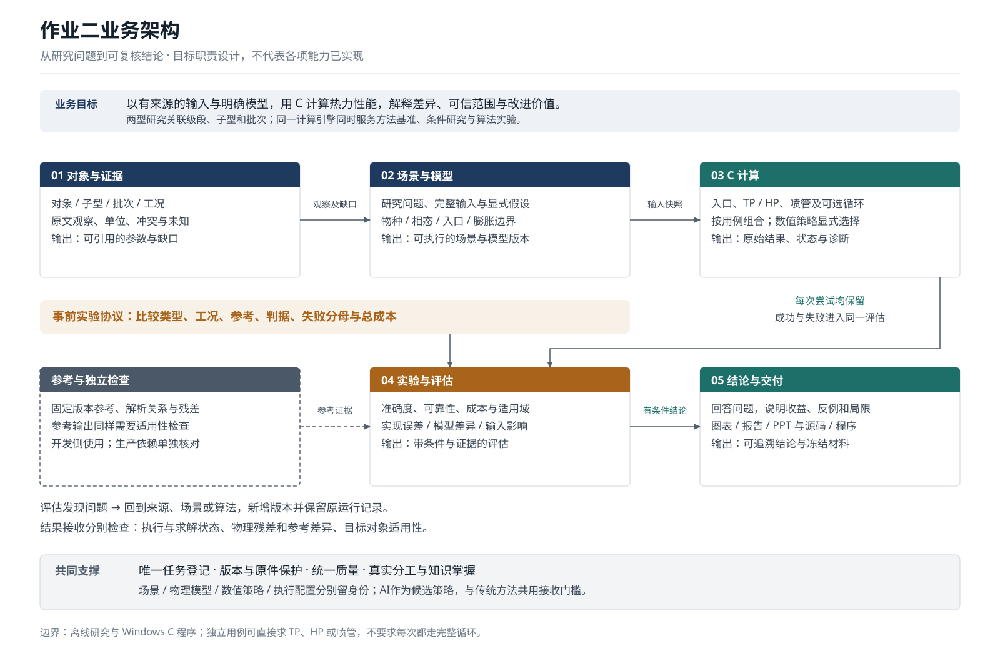

# 作业二业务架构：从研究问题到可复核结论

设计版本v1，2026-10-24，任务WARC-001。本文定义作业二的业务能力、信息归属和演进约束；它是项目设计决定，不是教师新增要求，也不表示下述目标能力均已实现。当前生产模块以根[模块登记](../../project/modules.json)为准，方法和输入限制以各模块契约为准。

## 1. 业务目标与边界

项目要交付：**以有来源的输入和明确的模型，用C计算两型发动机背景下的热力性能，并解释结果的可信范围、差异原因及一种改进是否有价值。** 每项研究从具体问题开始，以有证据的回答结束。

| 业务目标 | 需要回答的问题 | 对应产物与边界 |
|---|---|---|
| 完成课程热力计算 | C实际解了什么平衡问题，结果是否合理？ | 方程、C源码/发布版、可复跑案例；对应W2-R01/02/05 |
| 衔接两型与作业一 | 对哪个级段/子型/批次，哪些输入已知，哪些结论依赖假设？ | 对象与参数证据、条件场景、结果及局限；对应W2-R03/04 |
| 建立可信比较 | 实现误差、模型差异、输入不确定性各有多大？ | 验证协议、参考对照、敏感性和失败档案；对应W2-R08 |
| 形成研究贡献 | 相同物理验收门槛下，可靠性或总成本改善了多少？ | 强基线、消融、反例及采纳/停止决定；对应W2-R09 |
| 交付并能讲清楚 | 成员是否理解方法，四项材料是否一致并可接收？ | 源码、程序、报告、PPT及真实分工/演练/提交事实；对应W2-R06–13 |

当前产品边界是离线研究与Windows C计算程序。业务能力可以在同一仓库、一个程序和开发侧工具中协作；这份划分不要求拆成网络服务。冷却、寿命、瞬态、燃烧稳定性、实机改装和完整通用多相求解均未因此成为承诺。

## 2. 五项业务能力

图中实线为主要数据移交，虚线为开发侧参考支持；框表示职责，不能据框的存在判定软件完成度。实验协议在运行前规定比较方式和接受条件；评估发现问题后，回到相应来源、场景或算法，原记录保留。[Mermaid简图](business-architecture.mmd)与SVG由根`tools/work2_architecture.py`定义，统一通过`python tools/render_architecture.py`生成并检查漂移。

| 业务能力 | 负责什么 | 交给下游什么 | 必须守住的边界 |
|---|---|---|---|
| 01 对象与证据 | 两型/级段/发动机版本关系，来源核读、参数观察、冲突与未知 | 带对象、工况、单位、引用定位的观察和缺口 | 外部事实不能因进入算例而升级；不跨批次补齐参数 |
| 02 场景与模型 | 将研究问题变成完整计算问题，选择物理模型和显式假设 | 场景版本、模型/数据身份、输入快照、所求输出及限制 | 型号名只关联背景；数值由完整工况和模型决定 |
| 03 C计算 | 入口状态、TP/HP、喷管以及可选循环的组合求解 | 原始数值、状态、物理残差和累计工作量 | 不读取网页、任务状态或报告结论；未满足契约不交付有效解 |
| 04 实验与评估 | 固定协议、参考对照、算法/模型比较、敏感性、失败与成本分析 | 对指定量和范围的评估及可支持/不能支持的结论 | 求解成功与研究结论成立分别判断；参考输出也需检查 |
| 05 结论与交付 | 回答研究问题，形成图表、报告、程序说明和冻结材料 | 有适用条件和证据定位的研究结论、四项交付 | 图表来自保存结果；人工贡献、提交和签收只记录真实发生 |

任务、版本、来源保护、质量和人员协作横贯五项能力，复用现有治理。角色可以由同一成员承担，但计算结果、评估和科学审阅的证明范围分别写清；不因工具通过而虚构另一位审阅者。

## 3. 关键对象及其关系

下表是概念契约，已有文件足够时直接引用，不要求为每个对象新增JSON、数据库、C结构体或目录。名称便于在实现契约中精确讨论。

| 对象 | 最少需要表达的信息 | 关系与归属 |
|---|---|---|
| ResearchQuestion 研究问题 | 问什么、为何影响课程/研究、需要哪些输出、完成或停止条件 | 研究规划/专题和任务验收承接；一个问题可有多个实验 |
| TargetIdentity 研究对象 | 运载火箭、级段、发动机子型、批次/事件、控制体及已证实的关联 | 观察逐条关联对象；未知关系保留，不靠名称推断 |
| Observation 参数观察 | 原值/单位、规范化值/单位、工况、对象、来源定位、事实/派生/假设/未知 | 来源和观察在既有调查台账；假设在场景中单独声明，不能回写成观测 |
| Scenario 场景 | 问题、可选对象背景、用途、完整输入、每项来源/假设、所求输出 | 固定ModelSpec；同一对象可有多个情景，方法基准可不关联型号 |
| ModelSpec 物理模型 | 物种/相态、物性版本与基准、入口、平衡约束、喷管/冻结点、可选循环及适用域 | 描述所解方程和数据，不由数值策略暗改 |
| SolverPolicy 数值策略 | 方法、初值/热启动、缩放、容差、预算、校正/回退及缓存策略 | 多种策略求同一模型；当前只抽出实验需要替换的边界 |
| ExecutionSpec 执行配置 | 源码/构建/程序身份、编译选项、硬件、精度、线程、查询顺序、冷/热缓存 | 性能比较需要同等条件；所有隐含可变状态须显式记录 |
| ExperimentProtocol 实验协议 | 问题、比较类型、不变量/变化量、工况/划分、参考、判据、成本及停止条件 | 运行前冻结；探测集与正式保留测试集分别说明 |
| RunRecord 运行记录 | 唯一尝试ID、上述版本引用、原始输出/诊断、状态、哈希、时长 | 每次尝试独立留存，失败不从分母消失；扩展既有manifest而非另造运行系统 |
| Assessment 评估 | 哪些量通过哪些检查、参考差异、失败类别、域覆盖、局限与依据 | 引用RunRecord和协议；可以接受某范围、拒绝或证据不足 |
| ResearchFinding 研究结论 | 回答、证据、条件、反例、未知与影响 | 引用评估/原始运行；与来源表中的外部文献主张分别维护 |
| ReleaseBundle 交付版本 | 固定源码、程序、报告/PPT、数据链、许可说明和逐文件身份 | 交付清单引用研究结论；实际接收/上传仍是独立事实 |

主关系为：`来源 → 观察 → 场景`，`问题 → 协议 → 一组运行 → 评估 → 研究结论 → 交付`。运行同时绑定场景、模型、策略和执行配置；原始运行不因后续评估改变而改写。已有来源/参数表继续是主记录，场景保存引用和用于本次运行的数值快照。

## 4. 首批必须服务的用例

| 用例 | 前提及执行 | 输出与结束条件 |
|---|---|---|
| U1 单点方法验证 | 给定完整TP或HP问题，选择相同数据/物种的参考和事前判据 | 状态、组分/热力性质、残差、参考差异和适用范围；不强制经过喷管或循环 |
| U2 两型背景条件研究 | 按级段/批次整理证据，显式补充研究假设，选择请求的性能量 | 能支持的热力量、条件差异及缺口影响；资料不足时结束于有限结论 |
| U3 模型与输入影响 | 固定其余条件，改变物种/相态/入口/膨胀假设，或在有依据的输入范围内扰动 | 模型差异、灵敏度、结论是否改变；无概率依据时不生成置信区间 |
| U4 数值/学习改进 | 同一物理问题比较冷/热启动、延拓及候选预测/校正，冻结工作量与时间口径 | 同门槛的可靠性、误差、总成本、消融和采纳/停止理由 |
| U5 复核与交付 | 从保存输入和固定版本重建/复跑，将评估绑定图表和文字 | 可追溯四项材料、成功/拒绝示例、真实贡献与演练；自动检查不替人工签收 |

参数完整性按“请求的输出+模型”判断。缺喉面积时仍可研究组分、燃温及适用的比性能量，但不能报告由面积决定的绝对流量/推力；缺面积比/膨胀条件时也不能无条件给出口性能。缺室压或入口焓等必要输入时，计算场景须给出明确的研究假设或选择独立方法基准。台账中的未知继续为null，绝不把null、0或别的批次值自动当默认输入。

## 5. 场景、模型、算法、硬件分别变化

这四个边界使同一个C引擎既能支持两型研究，也能公平评价新算法：

- **场景**回答“算什么条件、为了回答什么”。压力、混合比、入口状态、几何、背压及来源/假设属于这里。
- **物理模型**回答“采用哪些方程和物性”。九气相或扩充物种、是否凝相、气态或液体入口、冻结或平衡膨胀分别有身份。
- **数值策略**回答“怎样解相同方程”。Newton、夹逼、缩放、初值预测、校正/回退及容差属于这里；Illinois只属于当前HP外层求根。
- **执行配置**回答“以什么实现和计算资源运行”。编译器、CPU/GPU、线程、精度、批量和缓存顺序属于这里。

核心不应出现按`engine_name`猜室压、面积比或切换算法的分支。适配器可以解析带型号背景的案例，但必须交给计算层完整数值输入和显式模型选择。改变模型或数据时建立新的身份；调整策略时仍需记录其版本，不能保持旧标签却替换行为。

## 6. C算子与引擎如何承接

目标是保留当前纯计算核心，逐步形成可替换、可诊断的求解边界。下面是职责设计，具体签名和统计schema由WBASE/WDEV依据审查制定；本文没有新增C API或改变现有失败输出约定。

| 计算职责 | 输入→输出 | 复用与约束 |
|---|---|---|
| 反应物/入口 | 物质身份、相态、T/p或显式焓及基准 → 元素库存、入口焓，必要时密度 | 温度求焓与指定焓入口分开；形成焓/显焓不重复计入；遵守固定RP-1与液体表各自有效域 |
| 热力性质与残差算子 | 固定数据及状态 → cp/h/s、化学势、守恒/平衡残差、所需导数 | 数据只读；单位/标准态显式；导数先有独立检查，不为每次标量运算增加调度层 |
| TP平衡 | T、p、元素库存、模型与策略 → 平衡态、检查量及诊断 | 守恒、平衡残差、非负性与准入分别判断；碳guard不等于通用相稳定性证明 |
| HP平衡 | p、元素库存、目标焓 → T及平衡态 | 可以嵌套TP或将来比较联立法；累计统计包含所有内部尝试，外层收敛不能掩盖内层失败 |
| 喷管 | 有效燃烧室状态、膨胀模型、几何/背压 → 喉部/出口状态和性能 | 可独立调用；冻结组分、熵/焓及质量流率条件一致；越域评估和附着求解分别出结果 |
| 循环组合 | 各支路、部件假设及边界 → 质量/元素/焓流与轴功闭合 | 按流量组合守恒量；复用HP和喷管；推力室求解不依赖循环必先完成 |
| 数值策略与workspace | 残差/必要导数、预算、显式工作区 → 状态与累计工作量 | 通用数值层不认识型号/报告/来源；只在比较实际需要时引入回调或策略接口 |

归一化的每kg元素库存和比焓，与循环中的质量流率、元素流率和焓流分别使用。喷管需要的是有效热化学状态及模型身份；不因同为double而混用质量/摩尔基准。

workspace由调用实例/调用方拥有，数据、临时内存、热启动和学习缓存分别说明生命周期。多个独立实例的可重入性与同一个实例的并发安全分别验证。累计诊断目标包括TP调用、内层总迭代、残差/Jacobian评估、线性求解、回溯、预测/回退；现有`equilibrium_iterations`只计最终TP延拓，尚不能提供完整HP成本。

**AI在架构中的位置：**候选初值、局部预测、选点或数值策略。初值预测之后仍求物理解；直接接受预测时必须通过相同的真实残差和模型准入检查，验证不足则回退，累计全部成本。不能只投影元素守恒就接受失衡组分。模型/知识库版本、加载/检索、顺序依赖、训练/生成/调参、校正与部署成本均进入实验。最终是否采用、是否需要GPU由WEXP决定。

## 7. 运行状态与科学接收分开

状态是不同维度，不建立另一套任务状态机：

| 维度 | 需要表达什么 | 典型处理 |
|---|---|---|
| 执行状态 | 是否启动/结束，超时、I/O、构建或校验失败 | 保留命令、日志、stdout/stderr和不可变尝试身份；不能回退引用旧成功 |
| 求解状态 | 输入非法、不支持、越域、无夹逼、不收敛、数值异常或有效解 | 失败不产生有效组合结果；诊断可单独返回，现有C失败保持输出不变 |
| 结果评估 | 对所求量，哪些守恒/残差/参考检查通过或证据不足 | 逐量/逐范围说明接受、拒绝或未决；参考有分歧先分析，不靠选喜欢的值解决 |
| 目标适用性 | 输入是否对应同批目标，假设和测量证据支持什么外推 | 即使数值通过，也可仅支持条件模型；没有实验时保留物理验证缺口 |

“正确拒绝”需要协议中预先给出的拒绝依据，不能把所有失败都归为正确拒绝。失败记录可支持健壮性结论；不能作为有效热力状态进入喷管、循环或性能均值。组合场景失败时，有效的中间算子诊断可以保留，但不能标记为组合成功。

收敛、残差合格和全局物理平衡并不天然等价。当前九气相条件和碳guard只支持已声明范围，不给未实现的相态、真实气体、反应速率或整机适用性背书。

## 8. 比较、误差和证据的放置

实验协议必须声明比较类型，避免把不同问题混成一个排行榜：

| 比较类型 | 固定什么 | 允许改变什么 | 回答什么 |
|---|---|---|---|
| 同模型实现/策略 | 输入、物种/相态、物性/标准态、方程、接受门槛 | 实现、求解策略；硬件比较另分组记录 | 正确性、健壮性和总成本 |
| 模型影响 | 共同输入与输出定义，其余假设尽量固定 | 明确的一项物种/相态/入口/膨胀假设 | 假设改变的影响；不能叫算法误差 |
| 输入敏感性 | 模型与数值验收 | 有依据的参数范围/情景 | 哪些缺失量主导结论、是否值得继续采集 |
| 两型/级段研究 | 输出口径、比较目的和控制体 | 各自有来源或声明假设的输入/模型 | 指定条件的差异；输入多项同时变化时不能归因于单个因素 |

指标及量纲沿用[质量标准](quality-standard.md)和[基准契约](../research/benchmark-contract.md)，WREF冻结实际阈值及理由。元素/焓/平衡残差是放行条件；温度/组分/c*/Isp误差、域内成功率、误接受、最大误差和端到端成本用于评价。内层/外层误差、物性/插值、模型截断和输入不确定性分别解释，不强行给出无依据的总百分比。

性能实验记录相同质量门槛下的中位数/P95、吞吐量、工作量和内存；失败/回退有分母。学习路线另报准备成本与摊销查询量。顺序/随机查询、冷/热缓存和工况块隔离由协议规定。正式测试集不能反复用于选择模型；探测结果用于设计协议时须标为探测，不再当未经接触的保留集。

检查器可以共享物性身份，但关键残差应尽可能从保存输入与状态独立复算，并有解析关系或其他实现补充。C/CEA/Cantera使用同源NASA数据时，仍主要是实现验证；没有测量和同批输入，不能据此宣称真实发动机精度。

## 9. 落在现有项目中的位置

| 信息/能力 | 当前主位置 | 本设计的接入方式 |
|---|---|---|
| 需求、问题与路线 | 本目录requirements、research-plan及根tasks登记 | 本文负责业务边界；任务仍由根工具维护 |
| 外部来源与参数观察 | Work2/research/data的source-index/claims/parameter-observations及原件 | 继续单处维护；场景引用观察ID，研究结论不混入外部来源主张生成器 |
| 物理模型与生产源码 | 根project/modules、docs/engineering和各专题契约，src/include | 本文给目标分责；签名/依赖变化先登记，再实现并更新工程图 |
| 输入案例 | 根cases及正式研究版本的输入快照 | Work2方法基准/条件研究分别标用途；只在实际创建时增字段及解析规则 |
| 构建与原始运行 | 根pipeline/运行manifest，临时build/work2 | 复用唯一尝试与失败机制；选定Work2研究版本进Work2/results |
| 协议、评估与结论 | Work2/research的专题/协议，Work2/results版本说明 | 用版本引用连接；需要结构化汇总时扩展既有工具，先定义schema与兼容性 |
| 图表与交付 | Work2研究档案及deliverables，旧交付仍在原址 | 图表读取保存结果；交付固定引用和哈希，不改旧包 |

期望的追溯关系是`输入/物性/模型/策略/构建 → 运行 → 评估 → 图表/结论 → 交付`。任一前提变化都要识别受影响结果并重新评估。现有统一质量已有输入指纹和构建新鲜度检查；细到全部科学主张的自动依赖失效传播尚未实现，当前通过manifest引用和显式审查承接，不能把设计目标说成已有功能。

## 10. 已有能力与目标差距

| 部分 | 已核实的工程起点 | 需要后续证明/补齐 |
|---|---|---|
| 证据 | 首轮来源、主张、参数/缺口、哈希及错误引用反证 | 同批关键输入仍缺；场景引用和更新影响需实案例闭合 |
| C热化学 | NASA9、受限九气相TP/HP、固定/连续入口及碳guard | 本阶段新鲜分层验证、累计成本、适用域和误差审查 |
| 喷管与循环 | 定比热/冻结喷管及条件循环原型，有旧归档 | 新阶段参考对齐；未因此获得通用平衡喷管/真实循环能力 |
| 运行与质量 | 构建/运行身份、失败记录、唯一任务、六组质量工具 | 新科学协议、分量评估及研究结论链的实际闭合 |
| 策略/学习 | 已有端点热启动和传统求解；ODML原文先例 | 可替换边界、导数/灵敏度、缓存及AI/GPU收益均待实验 |
| 课程交付 | 作业一材料就地归档，作业二要求已映射 | 作业二四件套、真实成员贡献及10分钟演练尚待完成 |

## 11. 分阶段落地与架构检查

1. **WBASE：让一条真实计算链可观测。** 固定场景/模型/数值/执行身份，分层复跑TP、HP、入口与喷管的成功/边界/失败；给出可继承项、诊断差距及瓶颈。先允许研究侧测量，不为诊断先重写整个引擎。
2. **WREF：让比较有契约。** 冻结工况、阈值、参考、比较类型、失败口径、输入敏感性及数据划分；先定义协议，再执行正式比较。
3. **WEXP：只抽出小实验需要的变化点。** 同模型比较传统策略和候选，计入预测、校正、回退和准备成本；有依据地采纳或停止。
4. **WDEV：将选定边界落实到C。** 通过模块登记/实现契约确定workspace、必要算子/策略接口与累计诊断，维护旧API语义和Windows运行依赖；按实际变化更新工程图。
5. **WDEL：以证据链冻结四项材料。** 两型案例与条件、结果/图表、报告和PPT一一对应；成员贡献和实际接收分别留事实。

这五步复用已有任务，不另建架构路线的第二任务板。任务状态只读[生成工作面](../worknow.md)。架构每次实质变更检查：

- 同一场景换策略时，是否保留物理问题和结果接收门槛？
- 同一型号有不同批次/假设时，能否并列记录且追踪每项输入？
- 一个请求失败后，调用方能否误读旧结果或半成品为本次成功？
- 一个通过数值检查的条件模型，能否在交付时仍明确其目标适用性？
- 给定一个图中数字，能否定位原始输入、模型、构建、运行与评估？

## 12. 两个设计走查案例

**TQ-12A产品观察：**原文面积比20.5属于产品栏观察。对象与证据层保存来源和栏目；场景层检查主室压力、混合定义、入口等是否完整。若缺失，则选择有明确假设的条件研究或独立方法基准，记录缺口；不得自动转成遥一/B型输入。只有完整场景才进C。评估说明数值验证和目标证据分别支持什么，报告引用该范围。

**HP初值预测实验：**冻结一组已经验证的场景与模型；现有策略和候选使用相同接受判据。预测失败、校正和完整求解回退全部写累计诊断；正式测试按协议隔离，随机/顺序查询分开。评估比较可靠性、最坏误差和总成本；无收益可以停止，仍形成有用结论。该例是设计走查，不是已运行实验。

设计依据为[教师要求](requirements.md)、[研究规划](research-plan.md)、[首轮方法调查](../research/method-review.md)、[C引擎调查](../research/c-engine-review.md)及现有模块/API契约；没有新增外部检索或独立性能结论。取舍记录于[决策表](decisions.md)，未解决边界见[审查记录](review.md)。
