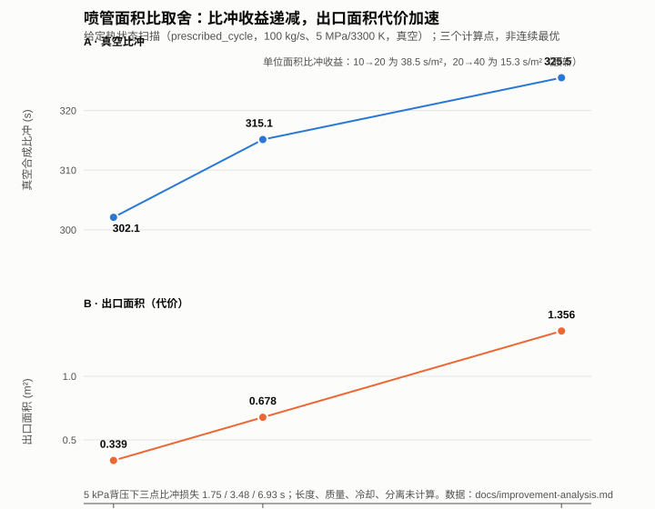

# 重复使用运载火箭动力系统性能研究报告

## 朱雀三号与长征十号乙

课程报告

---

## 摘要

本报告调查朱雀三号遥一与长征十号乙首飞的动力系统，并用C17程序在明确假设下计算发动机性能。公开资料能够确认两型的推进剂、级段和部分发动机配置，但不能组成室压、喉部面积、入口状态和循环参数齐全的单机性能卡。因此，型号调查与数值计算分别记录：前者使用已保存的制造商和机构原文，后者使用可复现的研究输入。

计算程序 `rocketperf` 的核心为C17，覆盖九气相定焓定压平衡、冻结喷管、液态甲烷入口、固定RP-1入口以及开式和富氧补燃循环。在共同室压10 MPa、喉部面积0.01 m²和真空条件下，液氧甲烷O/F=2.6的比冲为324.4251 s，固定RP-1同O/F的比冲为310.5717 s；二者推力只差343.5653 N。面积比由10增至40时，给定热状态算例的真空比冲由302.095 s增至325.508 s，但出口面积由0.338897 m²增至1.355590 m²。计算说明比冲收益、流量和几何代价必须同时比较，不能把这些条件结果称为两型实测性能。

---

## 1　研究目标

作业要求调查、分析和研究朱雀三号与长征十号乙动力系统的工作方案和工作能力，依据课程理论计算发动机性能，并进一步研究其优缺点和可能的改进。本报告据此确定三项目标。

1. 核对两型动力系统的级段、推进剂、发动机配置、起动和回收相关事实，并标明证据边界。
2. 建立可复现的C语言程序，计算燃烧温度、特征速度、推力、比冲以及循环中的质量、轴功和热量关系。
3. 在同一输入边界下比较推进剂、喷管面积比、背压、外排支路和入口状态，说明收益与代价。

公开资料缺少同批次室压、主室混合比、喉部面积、喷管面积比和供给状态。本报告不利用整箭总推力反推一套唯一的单机参数，也不把不同批次的产品参数拼接成飞行性能卡。

## 2　计算方法

### 2.1　推力室主线

程序按“入口状态、绝热燃烧、喷管膨胀、推力计账”计算。入口可以是给定气态焓、固定温度的液态反应物，或按温压查得的单相液体状态。燃烧采用定焓定压（HP）化学平衡：元素库存守恒，平衡常数闭合，求解绝热温度和气相组成。

物性采用NASA CEA v3.3.4的NASA九系数多项式。当前平衡使用H2、O2、H2O、CO、CO2、CH4、H、O、OH九种气相。N2不进入这一C/H/O平衡。每个收敛解另计算石墨活度

`a_C = exp(π_C − g°_C(gr) / RT)`。

`a_C > 1` 表示固体石墨在该温压下稳定，九气相结果不再作为平衡解，程序直接拒绝。`a_C ≤ 1` 只说明没有触发这一判据，不证明所有省略物种都可以忽略。

喷管采用燃烧室组分冻结、比热随温度变化的准一维模型。它以

`h_c = h + v² / 2`，`s = s_c`，`ρvA = mdot`

求声速喉部和超声速出口。程序同时保留定比热理想喷管，用于解析公式验证和单独的过膨胀诊断。

性能定义采用课程公式：

`F = mdot·ve + (pe − pa)·Ae`

`c* = Pc·At / mdot`

`CF = F / (Pc·At)`

`Isp = F / (mdot·g0)`

其中 `g0 = 9.80665 m/s²`。主室流量与整机消耗流量分别命名；存在外排支路时，支路流量和轴向推力进入整机推力账。

### 2.2　数值方法

全部核心计算使用 `double`，不启用 fast-math。定温定压平衡求解三个元素势和总摩尔量，采用解析雅可比矩阵、主元消元、阻尼牛顿法和线搜索。HP的温度外层使用保持夹逼区间的Illinois割线法，并利用已收敛状态热启动；必要时回退中点或冷启动。喷管标量方程使用二分法。

非有限值、非法输入、越域和不收敛都返回明确状态码。求解先写入临时结构，全部检查通过后才提交输出；失败时调用方原输出保持不变。附着喷管在 `pa > pe` 时拒绝，不把该点改记为零推力。独立的域评估接口可以给出理想出口压力、`pa/pe`、理想匹配面积比和 `0.4pa` 经验参考，但不计算激波、分离位置或侧向载荷。

### 2.3　循环模型

报告使用两个身份不同的循环模型。

历史模型 `prescribed_thermal_cycle_v1` 给定主室和发生器热状态，计算泵功、涡轮、外排支路和两路喷管，并用所需热量记账。它适合固定热状态的参数扫描，但不能把该热量称为绝热燃烧结果或冷却设计负荷。

新模型 `adiabatic_single_shaft_cycle_v1` 不输入燃烧温度。它由入口化学焓和元素库存求预燃室（或发生器）与主室的HP状态，两个燃烧过程均取 `Q = 0`。泵采用恒密度模型：

`P_p = mdot·(p_out − p_in) / (ρ·η_p)`。

单轴平衡为

`η_shaft·mdot_branch·w_t = P_fuel + P_oxidizer + P_aux`。

开式循环给定涡轮出口压力，由此求外排支路流量。富氧补燃循环令全部氧化剂通过预燃室，再由轴功和回流压力求解涡轮出口压力。回流气体的焓与元素进入主室，总推进剂消耗只计一次。两个模型都没有泵特性图谱、真实两相供给、冷却通道、瞬态过程或实机标定。

## 3　参数确定

### 3.1　已核对的型号事实

型号事实以保存的原始网页为准，首飞构型复核截止2026年10月3日，产品和试验资料补充截止2026年10月6日。

| 对象 | 已核对事实 | 来源 | 不能直接用于计算的内容 |
|---|---|---|---|
| 朱雀三号遥一 | 两级串联；一级9台TQ-12A，二级1台TQ-15A真空型；液氧甲烷；起飞质量约560 t，起飞推力7542 kN；二级二次起动；一级软着陆未成功 | 蓝箭航天，2025-12-03，V09 | 无同批单机室压、喉面积、面积比和主室O/F |
| TQ-15A历史状态 | 2022年资料给出真空推力836 kN、60%—110%变推，用于朱雀二号第二批次 | 蓝箭航天，2022-09，V11 | 不作为朱雀三号遥一标定值 |
| 长征十号乙首飞 | 一级液氧煤油，二级液氧甲烷；起飞推力约890 t，起飞质量约760 t；一子级网系捕获 | 火箭院，2026-07-10，V01、V02 | 约数保持原精度，不拆成单机精确值 |
| 长征十号乙一级 | 130吨级泵后摆液氧煤油发动机；采访称7台液发100系列，其中5台可摇摆、二次起动，2台固定 | 航天科技集团V06；央视采访V07 | 不补具体发动机后缀，不把吨级写成精确推力 |
| 长征十号乙二级 | 140吨级液氧甲烷发动机 | 航天科技集团，2026-07-15，V06 | 台数、循环、O/F和精确真空推力未确认 |

130吨级高压补燃液氧煤油发动机的技术背景见中国载人航天官网保存页L07。它支持煤油级段采用补燃方法情景，但不能证明长征十号乙首飞的具体子型、混合比或工作点。

设计复用次数、一次回收成功和已经完成的重复飞行寿命是三类不同事实。朱雀三号“不低于20次”是设计目标；遥一软着陆未成功。长征十号乙首飞完成了网系捕获，原文所述年底前复用飞行当时仍是计划。

### 3.2　研究计算输入

下列输入全部是研究假设，不贴真实单机性能标签。

液氧甲烷基线取 `Pc = 10 MPa`、`At = 0.01 m²`、甲烷120 K、氧100 K、两路入口压力10 MPa、O/F=3.4、面积比10、真空。固定RP-1路径取10 MPa、RP-1温度298.15 K、液氧90.170 K，已核验O/F范围为2.2—4.0。

两个一级循环情景均取总流量100 kg/s、主室10 MPa、主喷管面积比8、背压101325 Pa；泵入口1 MPa，燃料泵和氧化剂泵效率0.70、0.75，涡轮效率0.70，轴效率0.95，辅助功率10 kW。

| 输入 | 朱雀三号一级开式情景 | 长征十号乙一级补燃情景 |
|---|---:|---:|
| 燃料入口 | 甲烷120 K，氧100 K，液体表 | RP-1 298.15 K，液氧90.170 K |
| 总体O/F；预燃O/F | 3.4；1.0 | 2.6；30 |
| 泵出口；预燃室压力 | 13 MPa；11 MPa | 25 MPa；22 MPa |
| 涡轮出口压力 | 0.8 MPa，给定 | 求解，且须满足回流压力 |
| 支路 | 外排，面积比1.5，轴向投影1 | 全部氧化剂回流，无外排 |
| 输入文件 | `cases/vehicles/zq3_y1_stage1.ini` | `cases/vehicles/cz10b_first_stage1.ini` |

长征十号乙情景中的RP-1化学式为C1H1.95，燃料密度810 kg/m³为假设。它不是已确认的国产煤油批次。

## 4　程序设计思想与关键技术

### 4.1　分层与确定性行为

计算核心接收数值结构并返回结果或错误，不读取文件、网络、环境变量或界面状态。INI解析、单位检查、JSON和中文文本输出放在适配层。命令行与交互菜单调用同一求解接口，因此同一输入不因入口不同而改变数值结果。

这种边界使核心能够由C程序直接运行，也便于单独测试失败路径。Python只用于组织构建、归档和检查，不属于发布程序的物理计算依赖。

### 4.2　事务式输出

求解器在临时结果中完成物性、残差、范围和有限值检查。只有成功才写入调用方的输出结构。输入错误、数值失败或 `pa > pe` 越域都不会留下部分更新的推力、流量或比冲。批量命令用退出码区分用法错误、文件错误和求解失败，避免把所有非零退出误读成同一种物理原因。

### 4.3　模型身份与适用域

旧接口保持原有含义。气态HP、固定液态锚点、连续液体查表、固定RP-1、给定热状态循环和绝热循环使用不同模型和输入身份。新模型不通过隐式默认值改变旧算例。

石墨活度判据放在平衡层，因此各条九气相路径都能使用。它判断当前温压下石墨是否稳定，不预测积碳速率、位置或发动机寿命。固定RP-1公共接口维持10 MPa和O/F=2.2—4.0的验证范围，不把个别成功点延伸成所有煤油工况。

### 4.4　可复现记录

每次正式研究保存输入、输出、预期失败、程序构建身份和文件哈希。解析基准、模型内守恒、同条件CEA对照和拒绝反例分别记录。CEA使用同源NASA9数据，能够检查程序实现和物种集合差异，但不能代替发动机试验。

## 5　程序流程图

图中入口层负责读取和检查输入。`combustion` 进入HP平衡、冻结喷管和推力计算；`cycle adiabatic` 先经过泵、预燃室HP、涡轮和轴功闭合，再计算主室与喷管。理想喷管、给定热状态循环、域评估和研究扫描是各自的命令，不是同一条顺序调用链。

附着喷管遇到 `pa > pe` 时经失败出口返回，不自动转入域评估。域评估必须由调用者显式选择。成功结果写为JSON或中文表格；失败诊断写到错误输出，退出码2、3、4分别对应用法、文件或格式、求解失败。

## 6　程序说明

发布程序为Windows控制台程序 `rocketperf.exe`。构建命令为：

`python tools/pipeline.py build --configuration Release`

纯C源码也可以用CMake和Ninja构建。正式结果以记录构建哈希的程序为准，`build/release/rocketperf.exe` 是本地便捷入口。

无参数启动进入中文交互菜单；菜单逐项显示参数、单位和默认值，输入 `q` 取消。标准输入被重定向时，无参数运行返回用法错误，以避免脚本意外进入交互循环。发布目录中的 `rocketperf-run.bat` 用于显式启动菜单。

批量运行包括：

`rocketperf run CASE.ini`

`rocketperf nozzle regime CASE.ini --text`

`rocketperf cycle adiabatic CASE.ini --text`

`rocketperf study propellants 2.6 2.6 10 0 --text`

普通成功输出为JSON，`--text` 输出中文表格。例如：

`rocketperf cycle adiabatic cases/vehicles/zq3_y1_stage1.ini --text`

`rocketperf cycle adiabatic cases/vehicles/cz10b_first_stage1.ini --text`

退出码2表示命令用法错误，3表示文件、路径或格式错误，4表示求解失败。退出码4既可能是物理越域，也可能是数值不收敛，需要读取具体诊断。交互菜单最终返回0，只表示菜单退出，不代表菜单内每次计算都成功。

## 7　设计算例结果与分析

### 7.1　液氧甲烷方法算例

取第3.2节的液氧甲烷基线，C程序输出：

| 量 | 结果 |
|---|---:|
| 绝热燃烧温度 | 3602.756 K |
| 特征速度 | 1811.000 m/s |
| 质量流量 | 55.218 kg/s |
| 推力 | 173.721 kN |
| 真空比冲 | 320.812 s |

结果来自 `results/validation/liquid_combustion_v1`。同一入口下按O/F从高到低扫描时，特征速度和燃烧温度的峰值不在同一位置：所取网格上，特征速度在O/F约2.7达到1845.2 m/s，温度在O/F约3.7达到峰值。固定比热模型中特征速度随 `√(T/M)` 变化；本模型的比热比还随温度和组分变化，所以不能只按温度排序。

石墨活度随O/F降低迅速增大。10 MPa下，O/F=1.0时 `a_C = 0.883`，O/F=0.9时 `a_C = 1.09`。因此网格中O/F不超过0.9的点被拒绝。这个边界用于检查热力学适用域，不预测实际积碳过程。

### 7.2　液氧甲烷与固定RP-1的同条件比较

共同条件为10 MPa、喉部面积0.01 m²、面积比10、真空，两种方法都取O/F=2.6：

| 方法 | 比冲 / s | 推力 / kN | 特征速度差 |
|---|---:|---:|---:|
| 液氧甲烷 | 324.4251 | 172.6411 | — |
| 固定RP-1 | 310.5717 | 172.9847 | — |
| 甲烷减RP-1 | 13.8534 | −0.3436 | 82.2 m/s |

甲烷流量为54.26367 kg/s，RP-1流量为56.79696 kg/s。固定室压和喉面积时，`mdot = Pc·At / c*`，较高特征速度使甲烷流量低4.46%。比冲差来自这批流量所对应的有效排气速度差异。

推力应写成 `F = CF·Pc·At`。两种方法的推力系数约为1.7264和1.7299，推力只差0.20%。因此，较高特征速度本身不造成推力下降。把两种方法改到其他共同O/F后，推力差还会变号：O/F=2.8时约−95 N，O/F=3.4时约+278 N。

比较还依赖入口状态。甲烷使用120 K、100 K的液体查表状态，RP-1使用298.15 K和90.170 K的指定反应物。相同质量O/F也不等于相同当量比。此表适合分析方法差异，不能据此排列两种真实燃料或两型火箭的优劣。

### 7.3　喷管面积比与背压

给定热状态循环取总流量100 kg/s、主室5 MPa和3300 K。面积比变化时得到：

| 面积比 | 真空比冲 / s | 出口面积 / m² | 5 kPa下比冲变化 / s |
|---:|---:|---:|---:|
| 10 | 302.095 | 0.338897 | −1.748 |
| 20 | 315.143 | 0.677795 | −3.475 |
| 40 | 325.508 | 1.355590 | −6.931 |

面积比10增至20时，比冲增加13.048 s，出口面积增加0.338898 m²；20增至40时，比冲增加10.365 s，面积增加0.677795 m²。后一档使用更多出口面积，得到的比冲增量更小。

5 kPa下三个几何点仍可求解。背压使大面积喷管损失更多，但低背压下的净收益仍然存在，不能由此得出只有真空才应增大面积比。喷管长度、质量、冷却、侧载、分离和寿命都未计算。

### 7.4　海平面过膨胀的定比热诊断

另一个独立算例取总压8 MPa、总温3400 K、比热比1.2、气体常数350 J/(kg·K)、喉部面积0.01 m²、面积比40、海平面背压101325 Pa。附着求解因出口理想压力低于背压而拒绝。域评估给出：

| 量 | 结果 | 含义 |
|---|---:|---|
| 理想出口压力 | 16.7 kPa | 理想满流出口压力低于海平面背压 |
| 背压与出口压力之比 | 6.07 | 过膨胀程度 |
| 理想匹配面积比 | 9.92 | 使出口压力等于背压的面积比 |
| 0.4倍背压参考面积比 | 20.01 | Summerfield型经验参考 |
| 含压力项的理想推力 | 110.2 kN | 负压力推力已经计入 |

`0.4pa` 只是经验提示。它不能确定激波位置，也不证明真实流动已经在某一截面分离。

把该定比热输入改到真空后，面积比40、10和9.923的比冲分别约为323.196 s、298.846 s和298.680 s。因而从40改为精确海平面匹配几何，真空比冲代价约为24.516 s。这是两种几何的比较，不是同一喷管从真空飞到海平面的性能变化。

### 7.5　支路排气与入口状态

在第7.3节的合成循环中，仅把支路轴向投影从0改为1，推力增加1406.887 N，比冲增加1.434626 s。支路流量、轴功、热状态和主室条件不变。整机性能计算因此必须计入外排流量及其推力；管路、干扰、热防护和质量代价尚未计算。

连续液氧甲烷算例保持室压、喉面积、面积比和真空条件，仅把甲烷从120 K升至140 K、氧从100 K升至110 K。比冲增加0.280 s，推力减少9.718 N。原因是入口焓变化改变了特征速度和固定喉部所能通过的流量，推力系数几乎不变。这个结果不包含预热器功率、压降或相变，不能作为加装预热装置的建议。

### 7.6　两个一级循环情景

两个情景使用第3.2节的输入。现行C程序结果为：

| 结果 | 开式甲烷情景 | 富氧补燃RP-1情景 |
|---|---:|---:|
| 发生器或预燃室温度 / K | 1322.98 | 1244.44 |
| 主室温度 / K | 3614.07 | 3723.71 |
| 涡轮出口压力 / MPa | 0.800（输入） | 17.947（求解） |
| 支路流量 / kg/s | 1.93376，外排 | 74.62963，回流 |
| 主喷管流量 / kg/s | 98.06624 | 100 |
| 泵功率 / MW | 2.07958 | 3.19730 |
| 主喉面积 / m² | 0.0176791 | 0.0176055 |
| 总推力 / kN | 290.539 | 285.497 |
| 整机比冲 / s | 296.268 | 291.126 |
| 全局能量残差 / W | +0.0008 | +0.024 |

上表推力、比冲和温度与2026-10-13归档v2在所列位数上相同。归档中的全局能量残差分别为-0.896 W和+0.827 W；现行Illinois割线法把残差降到表中的+0.0008 W和+0.024 W，没有改变所列性能。开式情景的主喷管流量加外排流量等于100 kg/s，外排喷管贡献2.636 kN轴向推力。补燃情景的74.62963 kg/s回流与25.37037 kg/s新鲜燃料合并进入主室，推进剂没有重复计账。求得的17.947 MPa高于11 MPa回流压力下限。

开式发生器O/F=1.0时，`a_C = 0.869`，程序未拒绝；同一归档中的扩展产物CEA结果也没有石墨。但0.869距离判据1很近，若继续降低混合比以追求更低燃气温度，会先进入石墨稳定区。

两列结果的燃料、O/F、泵出口压力和循环拓扑都不相同，推力差不能单独归因于“补燃优于开式”或相反。朱雀三号二级与长征十号乙二级开式情景使用相同数值输入，结果必然相同，只能算同一工况的两次对象映射。

### 7.7　验证范围

| 检查 | 保存证据 | 可以支持的结论 |
|---|---|---|
| 定比热解析解 | 马赫数2理想空气基准及面积、背压缩放 | 所测公式和单位实现正确 |
| 守恒与失败路径 | 元素、焓、熵、流量、有限值和输出保持检查 | 模型内部一致，非法输入不会伪装成功 |
| 液氧甲烷对照 | 47次C运行、18张CEA卡；温度差最大0.004406 K | 保存工况的软件实现正确 |
| RP-1对照 | 33次C运行、21张CEA卡 | 指定RP-1及物种集合差异可解释 |
| 推进剂成对计算 | 57次C运行、8张新CEA卡 | 同几何比较及差值来自C程序 |
| 绝热循环 | 5个成功情景、4个预期拒绝、12张CEA卡、814项关系 | 所设情景的质量、轴功、元素和焓闭合 |
| 石墨判据 | 独立重算活度，对数差小于10⁻⁶ | 判据方向与CEA凝聚相结果一致 |

本报告使用的四组归档均完成了离线复核：液氧甲烷返回47次C运行和18次CEA对照，RP-1返回33和21，成对推进剂返回57和8，绝热循环返回9次运行、12次CEA和814项关系。软件通过不等于实机试验通过。

## 8　结论与感悟

公开资料已经足够完成两型动力系统的构型比较：朱雀三号遥一为9台TQ-12A加1台TQ-15A的液氧甲烷方案，长征十号乙首飞为一级液氧煤油、二级液氧甲烷。现有资料不足以计算四个级段的真实绝对推力和比冲，因为同批单机输入没有齐备，国产煤油批次也未与RP-1绑定。

在报告声明的假设内，计算支持以下判断。

1. 固定室压和喉面积时，推进剂造成的比冲差异主要体现为流量差异。第7.2节中甲烷比冲高13.8534 s，流量低4.46%，推力只差0.20%。若工程上固定的是推力，应重新计算喉面积或流量，不能直接沿用这组推力。
2. 扩大喷管能够提高低背压比冲，但单位新增出口面积带来的收益下降。第7.3节中，两档面积翻倍分别增加13.048 s和10.365 s，对应的新增面积约为0.339 m²和0.678 m²。
3. 海平面匹配与真空性能必须使用同一模型比较。第7.4节从面积比40改到9.923时，真空比冲代价约24.516 s；它与第7.3节给定热状态模型的23.413 s属于不同算例。
4. 外排支路应进入整机推力账。该合成算例中轴向投影由0变为1，推力增加1406.887 N，约占整机推力的0.5%。
5. 富燃发生器混合比存在由石墨稳定性给出的下界。10 MPa甲烷算例的边界位于O/F=0.9与1.0之间；当前开式情景取1.0，活度为0.869，余量有限。

这些结论随输入变化。取得同批次室压、几何、入口、燃料组成和支路参数后，应替换现有假设并重新运行，不在旧结果上人工修正。

本次工作也说明，课程中的推力、比冲、特征速度和喷管关系能够组成一个可检验的研究流程。真正困难的部分不是把公式写成程序，而是保持对象、工况和证据等级不混淆：整箭推力不是单机推力，设计目标不是已验证寿命，软件对照也不是试车数据。

## 9　参考文献

1. 课程课件：《第2章 推力室和发动机的主要参数》，2026年9月11日版本。推力、比冲和理想喷管公式见课件第9—19页。
2. 蓝箭航天。朱雀三号重复使用遥一运载火箭入轨圆满成功，2025年12月3日，https://www.landspace.com/news-detail.html?itemid=66。
3. 蓝箭航天。“天鹊”真空型发动机TQ-15A完成总装，2022年9月，https://www.landspace.com/news-detail.html?itemid=20。
4. 中国运载火箭技术研究院。长征十号乙，2026年7月10日，http://www.calt.com/n482/n498/c2579124/content.html。
5. 中国运载火箭技术研究院。创造历史！长十乙首飞成功，我国首次实现运载火箭可控回收，2026年7月10日，http://www.calt.com/n689/c2573694/content.html。
6. 中国航天科技集团。长十乙任务相关文章，2026年7月15日，https://m.spacechina.com/n2014703/n3482528/c4651819/content.html。
7. 北京日报客户端转央视新闻。成功回收！总台记者独家探访长征十号乙火箭长啥样？，2026年7月10日，https://xinwen.bjd.com.cn/content/s6a508848e4b03fa51a81379e.html。
8. 中国载人航天官网。130吨级泵后摆高压补燃液氧煤油发动机关键技术研究，https://www.cmse.gov.cn/dmt/cbw/zrht/2022nian/2022dsiq/202302/t20230221_52733.html。
9. Gordon S, McBride B J. Computer Program for Calculation of Complex Chemical Equilibrium Compositions and Applications: NASA RP-1311. NASA CEA v3.3.4源码、数据库及原始计算卡由项目按版本保存。
10. Bell I H, et al. CoolProp 7.1.0。用于甲烷和氧的单相流体参考状态及离线查表核对，https://coolprop.org/。

原始网页、计算输入、输出和文件哈希保存在项目的 `调研/原始来源/`、`cases/` 与 `results/` 目录。

## 10　组员分工

本组组员为崔笑睿、谢宝钦、李星辰、宋俊辉、何明轩、纪博闻。具体工作如下。

| 组员 | 主要工作 |
|---|---|
| 崔笑睿 | 朱雀三号与长征十号乙资料搜集，发动机配置、推进剂和来源版本核对 |
| 谢宝钦 | 参数台账、单位与工况整理，区分型号事实、派生量和未知量 |
| 李星辰 | 算例输入、计算结果和图表整理，核对报告数值与保存结果 |
| 宋俊辉 | 作业报告撰写、参考文献整理和结果表述检查 |
| 何明轩 | C语言核心算法，包括物性、化学平衡、喷管和数值求解 |
| 纪博闻 | C语言程序集成、命令行与交互入口、算例运行、测试和发布版本整理 |

代码工作主要由何明轩和纪博闻完成，其余组员分别承担资料、参数、数据核对和报告工作。
