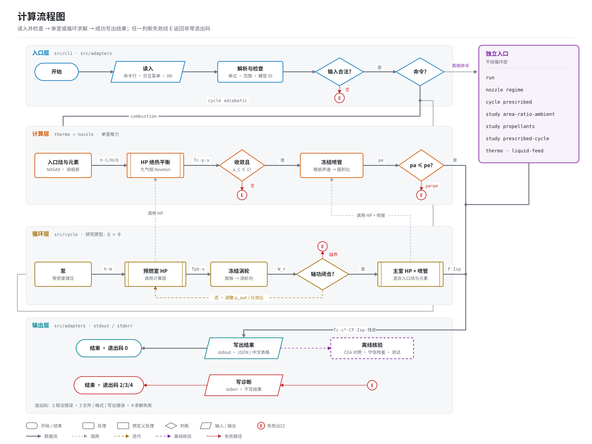

# 重复使用运载火箭动力系统性能研究——朱雀三号与长征十号乙

课程报告草稿，计算程序为C17控制台版 `rocketperf`。型号资料核验截至2026-10-03，产品与试验资料补充截至2026-10-06。组员分工见第10节。

本项目保存并核验的资料尚未给出同批发动机的完整输入：室压、喉部面积、喷管面积比、主室混合比、入口温压和循环支路状态。因此，构型调查采用文献事实，数值计算采用下文列出的研究假设；计算值不作为两型发动机的实测性能。

## 1. 研究目标

1. 调查朱雀三号、长征十号乙动力系统的工作方案与工作能力：级段配置、推进剂组合、发动机台数与已知动作（并联、二次起动、回收点火等）。
2. 用课程基本理论（推力室热化学平衡、特征速度、喷管膨胀、推力与比冲）建立可复算的 C 语言计算程序，在给定假设下计算发动机性能参数。
3. 在同一输入边界下做含计算的优缺点与改进分析：推进剂对比、喷管面积比与背压、支路排气计账、入口状态敏感性。

## 2. 计算方法

程序按"入口状态 → 绝热燃烧 → 喷管膨胀 → 推力计账"的推力室主线实现，全部为 C17 单进程计算：

| 环节 | 方法 | 说明 |
|---|---|---|
| 物性 | NASA 九系数多项式（NASA9），分温区 cp/h/s | 数据库含十物种；平衡采用 H2、O2、H2O、CO、CO2、CH4、H、O、OH 九气相子集，N2不参与此C/H/O平衡 |
| 燃烧 | 定焓定压（HP）化学平衡 | 元素库存守恒 + 平衡常数闭合，求绝热燃烧温度与平衡组成 |
| 入口 | 气态直接给定 / 固定锚点液态 / 单相液体查表 | 查表覆盖 CH4/O2 液体温压网格，化学焓与元素库存对齐 |
| 喷管 | 燃烧室冻结（温变比热）/ L0 理想（定比热） | 声速喉部、阻塞通量、超声速分支求根 |
| 推力 | F = ṁ·ve + (pe − pa)·Ae；Isp = F/(ṁ·g0) | ṁ为质量流量；压力推力项在过膨胀时为负 |
| 循环原型 | 历史给定热状态外排模型；另有新增Q=0绝热开式/富氧补燃模型ID | 旧模型给定两路热状态；新模型求预燃室/主室HP并显式闭合回流焓、元素和轴功；两者均非实机标定 |
| 域评估 | 独立的 regime 诊断接口 | 给出理想pe、pa/pe、匹配面积比及0.4pa经验参考，不计算激波或分离位置 |

数值策略：全程 `double`，不用 fast-math。TP组分内核求四个元素势/总摩尔量变量，采用解析Jacobian、带主元消元、阻尼Newton及线搜索；HP温度外层和喷管标量根采用夹逼二分。NaN/无穷/越域显式返回状态码，失败不改动输出缓冲。pa>pe时附着求解器拒绝，由独立regime接口提供理想解与经验提示。

绝热HP算例在稳态、Q=0和忽略入口动能/轴功的控制体内，以C/H/O库存守恒和`h_products(T,p)=h_in`求温度；给定热状态的历史循环另以所需热量记账，不能套用Q=0。冻结喷管以`h_c=h+v²/2`、`s=s_c`和`rho·v·A=mdot`求声速喉部及超声速出口。`c*=Pc·At/mdot`，`CF=F/(Pc·At)`，`Isp=F/(mdot·g0)`，其中`g0=9.80665 m/s²`。残差核对的是各自模型的方程。

## 3. 参数确定

### 3.1 型号事实（文献调查）

| 对象 | 已核对事实 | 计算边界 |
|---|---|---|
| 朱雀三号遥一一级（V09） | 9 台 TQ-12A，液氧甲烷；整箭起飞推力7542 kN、起飞质量约560 t | 构型/起动需求可讨论；无一致单机性能卡；不混入产品B型或遥二未披露后缀 |
| 朱雀三号遥一二级（V09） | 1 台 TQ-15A 真空型，二级二次起动 | 真空喷管研究方向；V11历史836 kN不作为遥一标定值 |
| 长征十号乙首飞一级（V01/V02/V06/V07） | 液氧煤油，7台液发100系列（5台可摇摆/二次起动、2台固定）；整箭起飞推力原文分别约890/900吨 | 原文推力语境为吨力，不能读成质量；固定RP-1已可计算，未绑定国产煤油或飞行发动机 |
| 长征十号乙首飞二级（V01/V02/V06） | 液氧甲烷，发动机140吨级描述 | 量级不等于精确真空推力；台数/子型/性能卡未知 |

来源与原文定位：[四级段研究](../docs/two-vehicle-study.md)、[证据台账](../调研/证据与参数台账.md)及[来源索引](../调研/原始来源/来源文件索引.json)。首飞事实原文复核截止2026-10-03；产品/试验参数补充截止2026-10-06。设计复用目标、回收成功与已验证复用寿命分别叙述。

### 3.2 计算假设（与型号解耦）

- 连续液态甲烷基线：Pc=10 MPa，At=0.01 m²，CH4=120 K、O2=100 K，两路入口均为10 MPa，O/F=3.4，面积比10，真空。原始输入见[基线输出的inputs字段](../results/validation/liquid_combustion_v1/base_A10-stdout.txt)。入口压力在此用于查表，不代表已经设计了供给系统压降。
- 固定RP-1锚点路径：10 MPa、O/F 2.2–4.0、RP-1 298.15 K/O2(L)90.170 K，已实现并核验的具名方法；国产煤油组成未知，不绑定真实燃料。
- 合成外排循环：100 kg/s、主室给定5 MPa/3300 K，支路热状态另行给定。它求分流、轴功、喷管和所需热量，适用于第7.3节的参数扫描。
- 绝热循环：从输入焓和元素库存求预燃室/主室温度，温度不是输入。两个一级情景的压力、流量、效率、混合比和输出见第7.6节；完整输入存于 `cases/vehicles/`。

## 4. 程序设计思想与关键技术

计算核心接收数值结构体，返回结果或错误状态，不负责文件、网络和菜单。INI解析与单位检查由适配器完成，命令行和交互菜单调用相同求解接口，因此同一输入不应因入口不同而得到不同结果。

求解器在临时结构中计算，全部检查通过后才写回结果；非法输入、越域或不收敛时保留调用方原输出。附着喷管求解对pa>pe返回越域，调用者可显式使用诊断接口查看理想状态。诊断结果附带限制，不冒充可用的附着流解。

每份研究归档保存输入、输出、失败记录及构建身份。单位测试检查解析关系和失败行为；参考对照检查保存工况中的数值差异，两类检查分别记录。

## 5. 程序流程图

图中各支路不是顺序调用链。`nozzle regime`是独立诊断命令；附着喷管求解遇`pa>pe`返回越域，不自动进入诊断。扫描重复调用对应求解入口，新循环与历史给定温度循环是两个模型ID，详见[集成对照](../docs/cycle-integration.md)。

## 6. 程序说明

- 构建：`python tools/pipeline.py build --configuration Release`（GCC，另支持Debug）；纯C源码包可直接用CMake/Ninja构建，无Python生产依赖。`build/release/rocketperf.exe`为便捷别名，正式交付固定已测试构建身份；Windows控制台UTF-8输出。
- 从真实控制台无参数运行 `rocketperf.exe` 会进入中文菜单；标准输入重定向时无参数返回用法错误。发布包可双击 `rocketperf-run.bat` 显式启动菜单。菜单逐项提示参数名/单位/默认值，`q`取消。
- 批量：`rocketperf run CASE.ini`、`nozzle regime CASE.ini [--text]`、`combustion regime-liquid-state ...`、`cycle adiabatic CASE.ini [--text]`、`study area-ratio-ambient ...`、`cases`列内置算例。
- 新循环研究入口示例：`rocketperf cycle adiabatic cases/vehicles/cz10b_first_stage1.ini --text`；正式归档与限制见[新循环验证](../docs/engine-cycle-validation.md)。旧的`cycle prescribed`契约仍独立存在。
- 普通命令成功时stdout为JSON，加 `--text`的入口输出中文表格；失败诊断写stderr。退出码2表示命令用法错误，3表示文件读写/格式错误，4表示求解失败（包括越域及数值失败），不能只凭4判定物理原因。交互菜单在屏幕上显示诊断并允许继续选择，退出菜单的0也不能代替内部算例成功检查。
- 理想喷管和部分燃烧/喷管交互入口提供过膨胀诊断；`cycle adiabatic`仍报告越域，不自动改换模型。`--text`只改变输出格式。

## 7. 设计算例结果与分析

### 7.1 液态甲烷基线（方法算例）

Pc=10 MPa、At=0.01 m²、CH4 120 K/O2 100 K、两路入口10 MPa、O/F=3.4、面积比10、真空：

| 量 | 值 |
|---|---|
| 绝热燃烧温度 | 3602.756 K |
| 特征速度 c* | 1811.000 m/s |
| 质量流量 | 55.218 kg/s |
| 推力 | 173.721 kN |
| 真空比冲 | 320.812 s |

归档及原始精度见[液体基线](../results/validation/liquid_combustion_v1/manifest.json)。表格保留的位数用于复算，不表示实机预测精度。软件参考差异见第7.7节。

### 7.2 推进剂对比（甲烷 vs 固定 RP-1）

共同边界Pc=10 MPa、At=0.01 m²、两方法O/F=2.6、面积比10、真空。这里甲烷O/F从上一节3.4改为2.6：甲烷比冲324.4251 s、推力172.6411 kN；RP-1比冲310.5717 s、推力172.9847 kN。甲烷比冲高13.8534 s而推力低343.5653 N，固定Pc/At时`mdot=Pc·At/c*`使其流量较低。共同O/F不等于共同当量比，入口状态也不同；不构成四级段真实性能排名。输入、57次C运行和8张新CEA卡见[成对研究](../docs/propellant-method-comparison.md)。

### 7.3 喷管面积比与背压（改进方向，含代价）

合成循环边界（100 kg/s、5 MPa/3300 K）下：

| 面积比 | 真空合成比冲 (s) | 出口面积 (m²) | 5 kPa环境的比冲变化 (s) |
|---|---|---|---|
| 10 | 302.095 | 0.338897 | −1.748 |
| 20 | 315.143 | 0.677795 | −3.475 |
| 40 | 325.508 | 1.355590 | −6.931 |

这组扫描固定总流量与给定热状态，扩大的是出口面积。面积比10→20的比冲增益13.048 s，增加出口面积0.338898 m²；20→40的增益10.365 s，增加面积0.677795 m²。后一段增加的面积更多、比冲增益更小。在5 kPa背压下，三点仍可求解，压力项使大喷管的增益缩小。以上只能支持在这三个点中按空间约束筛选，不能确定连续最优值；长度、质量、冷却、侧载和寿命未计算。[输入与结果](../docs/improvement-analysis.md)

### 7.4 海平面过膨胀诊断（定比热研究情景）

[研究输入](../cases/research/s3_sealevel_regime.ini)：P0=8 MPa、T0=3400 K、gamma=1.2、R=350 J/(kg·K)、At=0.01 m²、面积比40、pa=101325 Pa。这是L0定比热情景，未绑定真实一级发动机。附着求解器拒绝（pa>pe），域评估给出：

| 量 | 值 | 读法 |
|---|---|---|
| 理想出口压力 pe | ≈16.7 kPa | 理想附着解低于海平面背压 |
| pa/pe | ≈6.07 | 过膨胀程度 |
| 匹配面积比 | ≈9.92 | 该背压下 pe=pa 的理想几何 |
| 0.4pa 参考面积比 | ≈20.01 | Summerfield 型经验提示线，非分离预测 |
| 含压力项理想推力 | ≈110.2 kN | 压力推力项为负已计入 |

结论：在上述全部假设下，理想出口压力低于背压及0.4pa经验参考线；该诊断说明压力失配，不证明真实附着流已失效，不确定分离位置、侧载或真实推力。约9.92/20.01的面积比是模型反解参考，不是设计建议。

### 7.5 循环边界与入口敏感性

- 支路排气轴向投影 0→1：推力 +1406.887 N、比冲 +1.434626 s——发动机计账不能漏外排流量与推力；未算布管/干扰/热防护代价。
- 入口焓响应（Pc/At/几何/真空不变，CH4 140 K/O2 110 K）：比冲 +0.280 s 而推力 −9.718 N——`mdot=Pc·At/c*` 使通量下降，评价改进不能只看比冲。

### 7.6 两个一级循环情景：输入、闭合关系与结果

本节检查开式和补燃的质量、轴功及热量如何闭合。共同假设为稳态、100 kg/s总供给、10 MPa主室、主喷管面积比8、101325 Pa背压；两路泵入口1 MPa，燃料/氧化剂泵效率0.70/0.75，涡轮效率0.70，轴效率0.95，辅助功10 kW，泵到主室及预燃室压降均声明1 MPa。

| 其余输入 | 朱雀三号一级背景的开式情景 | 长十乙一级背景的富氧补燃情景 |
|---|---|---|
| 燃料及入口温度 | CH4 120 K、O2 100 K，液态表焓/密度 | 指定RP-1 298.15 K、O2(L)90.170 K；燃料密度假设810 kg/m³ |
| 总体O/F；预燃O/F | 3.4；1.0 | 2.6；30 |
| 泵出口；预燃室压力 | 13；11 MPa | 25；22 MPa |
| 涡轮出口压力 | 输入0.8 MPa | 由轴功求解；须不低于主室压力+1 MPa回流压降 |
| 支路去向 | 独立外排喷管，面积比1.5、轴向投影1 | 全部氧化剂通过预燃室/涡轮并回流主室；无外排喷管 |
| 计算输入 | [zq3_y1_stage1.ini](../cases/vehicles/zq3_y1_stage1.ini) | [cz10b_first_stage1.ini](../cases/vehicles/cz10b_first_stage1.ini) |

恒密度泵功为 `Pp=ṁ·(pout−pin)/(ρ·ηp)`；轴功平衡为 `ηshaft·ṁbranch·wt=Pp,f+Pp,o+Paux`。开式由给定压力膨胀得到涡轮比功wt，再求支路流量。补燃则按 `ṁpb,o=ṁo`、`ṁpb,f=ṁo/(O/F)pb`确定流量，再求满足轴功及回流压力的涡轮出口压力。两燃烧过程均令Q=0，用实际进入的化学焓和元素库存求HP；补燃主室入口包含涡轮回流及剩余新鲜燃料。

| 求得的量 | 开式情景 | 富氧补燃情景 |
|---|---:|---:|
| 发生器/预燃室温度 (K) | 1322.98 | 1244.44 |
| 主室温度 (K) | 3614.07 | 3723.71 |
| 涡轮出口压力 (MPa) | 0.800（输入） | 17.947（求得） |
| 支路流量 (kg/s) | 1.93376，全部外排 | 74.62963，全部回流 |
| 主喷管流量 (kg/s) | 98.06624 | 100.00000 |
| 泵功率 (MW) | 2.07958 | 3.19730 |
| 求得主喉面积 (m²) | 0.0176791 | 0.0176055 |
| 总推力 (kN) | 290.539 | 285.497 |
| 整机比冲 (s) | 296.268 | 291.126 |
| 全局能量残差 (W) | −0.896 | +0.827 |

开式主喷管流量加外排流量为100 kg/s，外排仍贡献2.636 kN轴向推力。补燃回流74.62963 kg/s与新鲜燃料25.37037 kg/s一起进入主室，只计一次总消耗；17.947 MPa高于11 MPa回流压力下限。残差按预设容差接受，其数量级不能解释为实机测量误差。原始状态和四个拒绝案例见[循环归档](../results/research/engine_cycles_v2_20261013/manifest.json)。

两列的燃料、混合比和供给压力不同，不能用比冲差评价开式与补燃的优劣。其余三个情景用于二级入口演示，其中朱雀三号二级与长十乙二级开式输入数值相同、仅来源角色不同，结果也相同；它们不构成两个独立的物理验证点。长十乙二级补燃情景另行提高泵后压力并更改支路拓扑，其差值含多项输入变化，不能视为只改变循环的收益。

### 7.7 验证范围

| 检查 | 内容 | 能支持的结论 |
|---|---|---|
| 解析极限 | L0 理想喷管对教科书公式、恒密度泵功 | 所测边界条件下实现与解析关系一致 |
| 守恒与边界 | 物理残差、输入域、失败输出保持；断言包含大量重复与负向检查 | 模型内自洽与接口回归 |
| 甲烷同源对照 | 47次C/18张显式焓CEA卡；室温最大差0.004406 K、c*最大差0.003504 m/s | 连续入口方法在保存条件下的软件核验 |
| RP-1同源对照 | 33次C/21张CEA卡；同九物种参考采用0.02 K打印感知容差；扩展产物内部点燃温差0.31–0.46 K | 数值实现与产物集合差异分别解释 |
| 成对方法 | 57次C/8张新CEA卡；共同几何、各自入口及C差值逐字段核对 | 条件性比较，不是燃料或型号排名 |
| 新循环状态 | 5成功情景、4预期拒绝、12张CEA部件HP卡、814项状态关系；九气相温差约0.004 K以内，扩展产物差值最高约0.392 K | 所测假设情景的部件软件对照与守恒核验，不是实机循环或实验验证 |
| 工程质量 | 重新构建、输入/输出检查、归档哈希及包内运行 | 所交程序和保存证据对应，不能替代实机试验 |

证据分别见[甲烷验证](../docs/liquid-combustion-validation.md)、[RP-1验证](../docs/kerosene-validation.md)、[成对研究](../docs/propellant-method-comparison.md)、[新循环验证](../docs/engine-cycle-validation.md)和[质量规范](../docs/governance.md)。CEA/NASA9物性同源；CoolProp查表对照检验生成与插值流程；两者均非独立发动机实验。

## 8. 结论与感悟

原文能够支持朱雀三号遥一一级9台TQ-12A、二级1台TQ-15A，以及长十乙首飞一级煤油、二级甲烷的构型讨论。现有资料不能把同批室压、喉面积、入口状态、主室O/F和循环损失连成单机输入卡。因此第7节的推力与比冲属于注明条件的计算结果，不作为两型实测性能。

改进方案只能在其输入边界内提出。第7.3节的面积比10→40使合成真空比冲增加23.413 s，同时主出口面积由0.338897增至1.355590 m²；5 kPa背压下的损失由1.748增至6.931 s。第7.4节的海平面定比热情景则可把匹配面积比约9.92作为**初筛候选**，但面积比40的理想附着推力位于本模型越域侧，不能用其110.2 kN与候选结果作真实收益承诺。真实取舍还需要长度、质量、冷却、流动分离和飞行背压历程。

定流量的循环扫描与固定喉面积的单喷管响应回答不同问题：前者按质量流量求喉面积，后者按喉面积求质量流量。计算前必须确定哪个量由硬件或工况约束。后续若取得同批室压、几何、入口和支路数据，可替换本报告的假设并重新计算；燃料组成、实机泵/涡轮图谱及整机参考缺失时，仍不能估计真实发动机误差。

## 9. 参考文献

1. 课程课件：《第2章 推力室和发动机的主要参数》（2026-09-11 版）。
2. 课程公式、单位及课件页码：[RES-003公式与基准](../调研/专题/RES-003_公式与基准.md)。未直接定位页码的教材不作为定量结论证据。
3. NASA CEA v3.3.4，固定源码/数据库与原卡原输出：[参考复现](../docs/reference-reproduction.md)、[NASA9来源与核验](../docs/thermo-validation.md)。
4. Gordon, S., McBride, B. J. NASA RP-1311：指定反应物与焓处理定位见[液态与煤油专题](../调研/专题/RES-006_液态与煤油入口.md)。
5. V01/V02/V06/V07/V09等制造商与采访来源：标题、发布日期、原URL和适用范围见[证据台账](../调研/证据与参数台账.md)；原文行定位见[四级段研究](../docs/two-vehicle-study.md)。
6. CoolProp 7.1.0 HEOS，单相离线参考与摩尔焓对齐：[连续液体基准](../调研/专题/RES-007_连续液体基准.md)、[查表验证](../docs/liquid-feed-validation.md)。

## 10. 各组员分工说明

见 `deliverables/contributions.md`。分工需全体组员确认后定稿（当前为待确认模板）。
