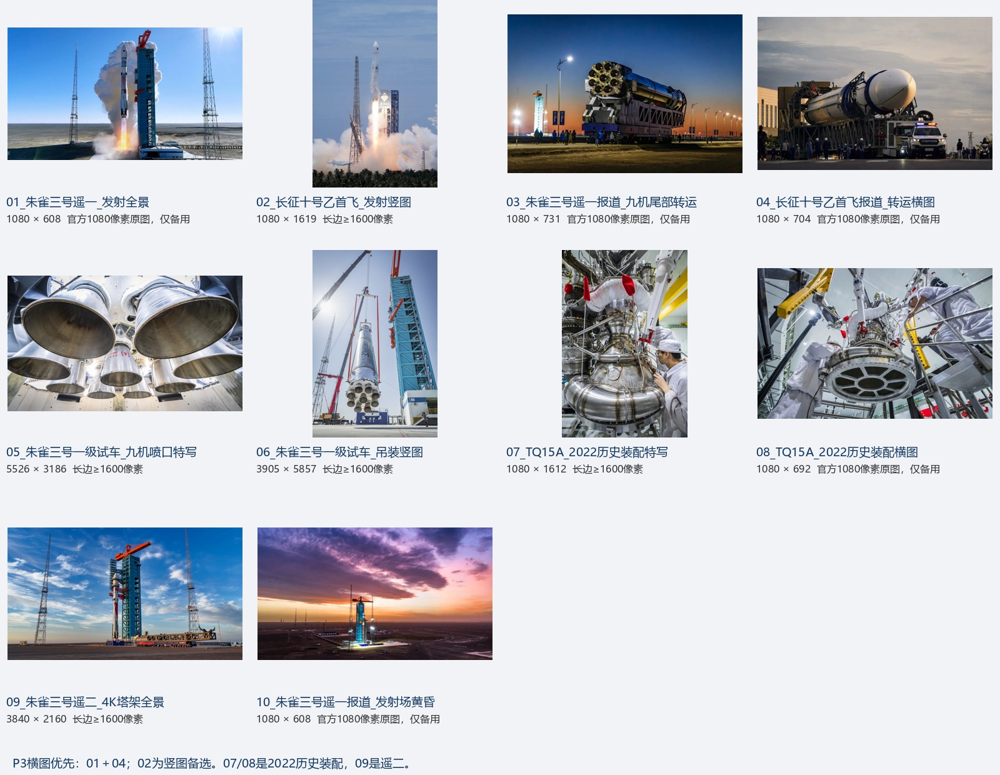

# PPT图片备选：先看总览，再按编号选图

## 现在怎么用

- P3推荐左边01（朱雀三号遥一发射）、右边04（长十乙转运）。两张均来自对应官方报道，适合横向布局；它们只有1080像素长边，放半页尚可，不放大到全屏特写。
- 若希望展示长十乙发射，换02竖图，使用“裁剪→适应”保留箭头与尾焰，不强裁成横图。
- 05/06/07/09属于长边1600像素以上的原图，加上02共5张；另外5张是1080像素备用，分目录保存。
- 05用于喷口实物背景，不能替代P9性能曲线；07/08必须注明2022年历史装配；09必须注明遥二。
- 后续架构图、流程图由用户提供，本目录没有用网络示意图替代项目图。

## 来源与身份

| 编号/原图 | 尺寸 | 图注与用途 | 官方来源 |
|---|---|---|---|
| [01_朱雀三号遥一_发射全景](02_1080像素备用/01_朱雀三号遥一_发射全景.jpg) | 1080×608 | 朱雀三号遥一发射（2025-12-03）；P3左图优先；可作封面背景 | [原页面](https://www.landspace.com/news-detail.html?itemid=66) |
| [02_长征十号乙首飞_发射竖图](01_高清原图_长边1600以上/02_长征十号乙首飞_发射竖图.png) | 1080×1619 | 长征十号乙首飞发射（2026-07-10）；P3右图竖图备选；不宜强裁为横幅 | [原页面](http://www.calt.com/n689/c2573694/content.html) |
| [03_朱雀三号遥一报道_九机尾部转运](02_1080像素备用/03_朱雀三号遥一报道_九机尾部转运.jpg) | 1080×731 | 朱雀三号遥一报道中的九机尾部转运；P3左图备选；动力系统背景 | [原页面](https://www.landspace.com/news-detail.html?itemid=66) |
| [04_长征十号乙首飞报道_转运横图](02_1080像素备用/04_长征十号乙首飞报道_转运横图.png) | 1080×704 | 长征十号乙首飞报道中的转运照片；P3右图优先，适合与01配对 | [原页面](http://www.calt.com/n689/c2573694/content.html) |
| [05_朱雀三号一级试车_九机喷口特写](01_高清原图_长边1600以上/05_朱雀三号一级试车_九机喷口特写.jpg) | 5526×3186 | 朱雀三号一级九机并联地面试车报道（2025-06-20）；P9喷管实物备选或讲解背景；不能替代结果曲线 | [原页面](https://www.landspace.com/news-detail.html?itemid=64) |
| [06_朱雀三号一级试车_吊装竖图](01_高清原图_长边1600以上/06_朱雀三号一级试车_吊装竖图.jpg) | 3905×5857 | 朱雀三号一级动力系统试验箭体吊装；P3或P13的结构背景备选 | [原页面](https://www.landspace.com/news-detail.html?itemid=64) |
| [07_TQ15A_2022历史装配特写](01_高清原图_长边1600以上/07_TQ15A_2022历史装配特写.jpg) | 1080×1612 | TQ-15A发动机装配特写（2022年报道）；发动机实物备用；配2022年历史装配图注 | [原页面](https://www.landspace.com/news-detail.html?itemid=20) |
| [08_TQ15A_2022历史装配横图](02_1080像素备用/08_TQ15A_2022历史装配横图.jpg) | 1080×692 | TQ-15A发动机装配横图（2022年报道）；发动机介绍备用，小幅使用 | [原页面](https://www.landspace.com/news-detail.html?itemid=20) |
| [09_朱雀三号遥二_4K塔架全景](01_高清原图_长边1600以上/09_朱雀三号遥二_4K塔架全景.jpg) | 3840×2160 | 朱雀三号遥二发射报道中的塔架全景（2026-08-19）；高分辨率外观/场景备用，图注明确遥二 | [原页面](https://www.landspace.com/news-detail.html?itemid=76) |
| [10_朱雀三号遥一报道_发射场黄昏](02_1080像素备用/10_朱雀三号遥一报道_发射场黄昏.jpg) | 1080×608 | 朱雀三号遥一报道中的发射场黄昏；P1/P14氛围照片备选 | [原页面](https://www.landspace.com/news-detail.html?itemid=66) |

## 使用边界

上述图片逐张目视检查未见额外平台/摄影署名水印，未做去水印、放大或画面修补。箭体上的国旗、厂商品牌与车间标语属于实物画面，予以保留。没有因无水印就宣称图片免版权；PPT备注保留官方来源。

原图URL、下载日期、字节数和SHA256见[来源清单](来源清单.json)。原页面文字只用于确认图像身份，本轮图片检索不更新报告的型号事实截止日期。

Grok两次请求均无搜索轨迹，第一次还存在错误厂商归属，均未作为图片来源。实际图片均从项目既有官方来源页面重新HTTP读取并提取img src；网页和图片实际可访问，与第二次Grok返回的不可访问说法不同。
