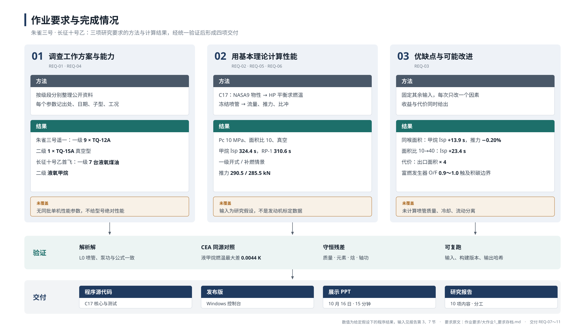
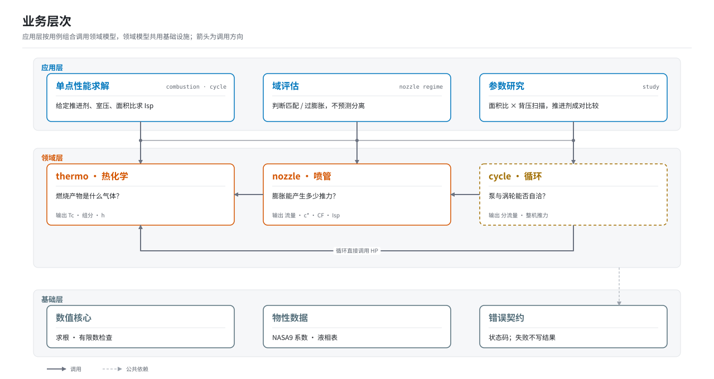
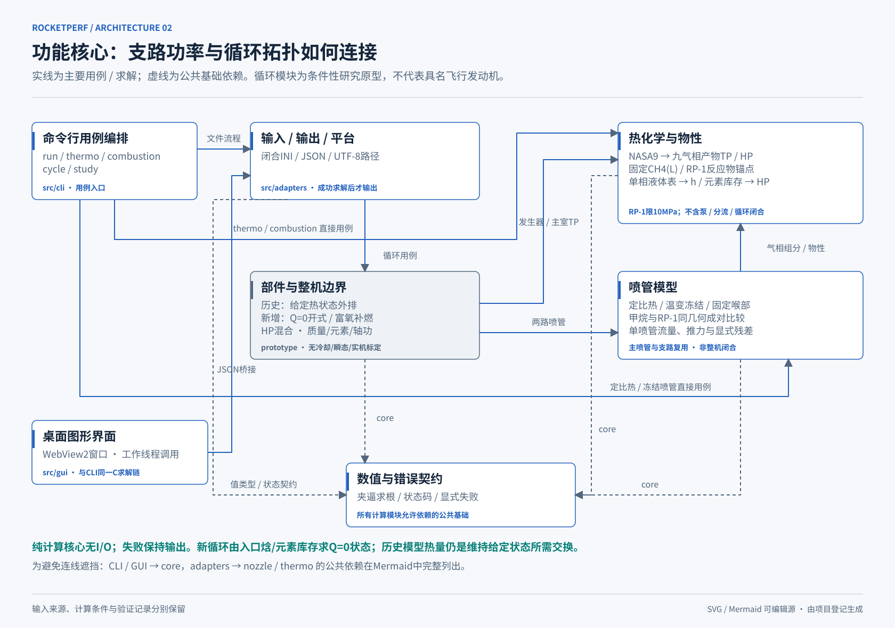
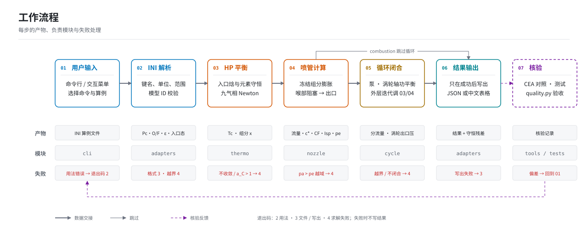

# 作业对接与工程架构

打开[离线架构浏览页](index.html)，先看作业对接总览，再切换业务、计算和执行三视图。图中文字可选取、链接可离线跳转；不依赖网络或CDN，可直接打印。

报告和展示使用[计算入口流程图](report-flow.svg)，生成命令为 `python tools/report_flow.py`。图中L0、推力室、给定温度循环、绝热循环及regime分别调用；旧 `live/slide-flow.svg`只保留历史演示，不能作为现行调用流程。

## 作业对接总览

三条老师研究要求对应“证据与参数 → C计算 → 条件性改进分析”，共同验证支撑源码、发布版、PPT、报告四项交付。它区分老师要求、项目实现选择、已有方法和未覆盖项，不画虚假的完成率。REQ编号对应[映射](../requirements-map.md)，入口焓及热边界见[审阅](../research-thermal-boundary.md)。[Mermaid源](assignment.mmd)保留简版逻辑，SVG是为阅读设计的详细布局。

## 业务层次

应用层（单点求解、域评估、参数研究）按用例组合调用领域层的热化学、喷管、循环模型；三者共用数值核心、物性数据与错误契约。物性数据在代码中随thermo编译，图中按职责放在基础层。

## 功能核心

固定RP-1/O₂(L)公共入口复用九气相HP内核，仅支持10 MPa与O/F=2.2–4.0、精确指定温度；见[接口核验](../kerosene-validation.md)。它补充煤油类方法算例，不代表国产煤油批次或完整循环。

实线表示主要编排/调用，虚线表示公共接口依赖。图中循环模块并存历史给定热状态外排模型和新增Q=0开式/富氧补燃原型；后者将混合回流的焓/元素库存带入HP，但不代表两型飞行性能卡。循环原型不求泵图谱、真实液相供给、冷却或瞬态。[新循环验证](../engine-cycle-validation.md)和[集成对照](../cycle-integration.md)给出模型ID、方程、算例及限制。公共依赖完整清单见[Mermaid源](components.mmd)。

## 工作流程

一次研究计算的七步：输入、解析、HP平衡、喷管、循环闭合、输出、核验，每步列出产物、负责模块和失败退出码。combustion不经循环层；核验在单次运行之外，偏差未解释时回到输入。任务状态机（READY→ACTIVE→REVIEW→DONE）见[治理说明](../governance.md)。

## 维护图的方式

- 模块名、角色、状态、源码和允许依赖维护于`project/modules.json`。
- 作业布局/说明维护于`tools/assignment_diagram.py`；三视图布局在`tools/architecture_views.py`，统一图元与配色在`tools/diagram_style.py`，由`tools/render_architecture.py`统一生成。
- 运行`python tools/render_architecture.py`生成SVG、Mermaid及HTML。修改图形后渲染检查文字、连线和边界，不能只凭生成成功。
- `python tools/project.py check`验证图与登记/生成源一致；生产依赖变化会要求同步布局，避免图看起来漂亮却失真。

作业总览与三视图均已在本机渲染并视觉核对。各图保留SVG原图和Mermaid文本，便于编辑和讨论中复用。详尽模型假设仍以[工程契约](../engineering.md)为准，任务规则见[治理说明](../governance.md)。
